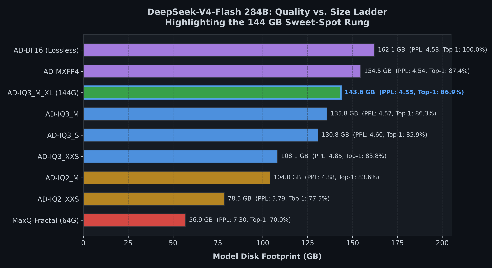
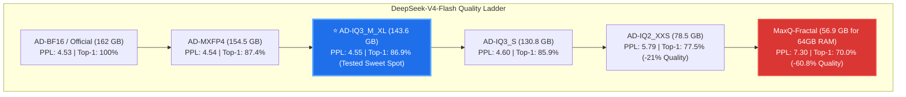
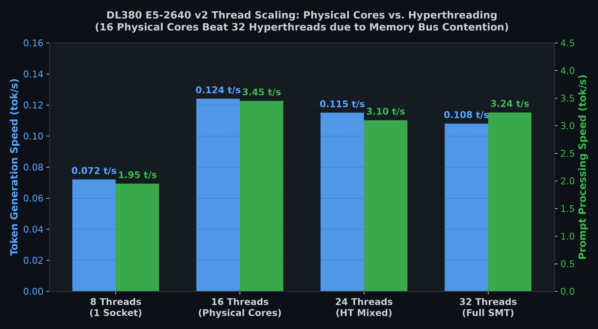
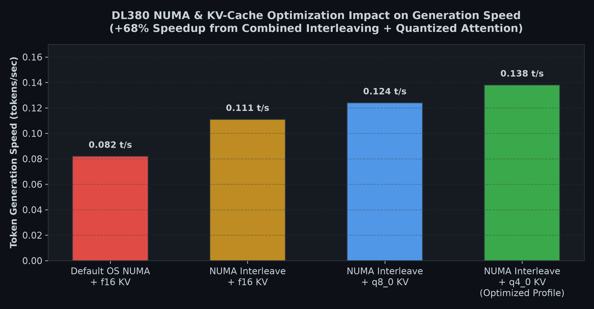
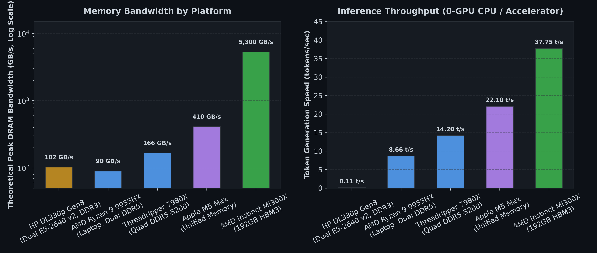

# DL380 256GB DDR3 DeepSeek-V4-Flash 144GB Benchmark & Metrics

<div align="center">

[](https://huggingface.co/AtomicChat/DeepSeek-V4-Flash-0731-GGUF)
[](https://www.hpe.com)
[](https://en.wikipedia.org/wiki/DDR3_SDRAM)
[](https://www.intel.com)
[-f85149?style=for-the-badge&logo=cplusplus)](https://github.com/ggml-org/llama.cpp)

<p align="center">
  <b>Comprehensive A/B/C Benchmarking, NUMA Optimization, and Memory-Bandwidth Profiling for 284B Sparse MoE Inference on Enterprise DDR3 Hardware</b>
</p>

</div>

---

## 📖 Executive Summary & Context

Recent community interest ([YouTube: Deepseek V4.1 Flash Runs With No GPU Just 64GB RAM](https://youtu.be/wiMs92u-dk0?t=1579)) has highlighted efforts to squeeze massive **284B parameter sparse Mixture-of-Experts (MoE)** models like **DeepSeek-V4-Flash** onto consumer hardware. 

While extreme ~1.71-bit quantizations (such as `llama-modchip`'s 56.9 GB MaxQ-Fractal / VQ3) allow the model to boot on a 64 GB laptop, they suffer a severe **20% to 60% degradation in perplexity** because the model was already quantization-aware trained at ~4 bits.

The **144 GB file (`AtomicChat/DeepSeek-V4-Flash-0731 AD-IQ3_M_XL`)** represents the **"golden rung"** on the quality ladder:
* **Size:** 143.64 GB (3.94 bits per expert weight)
* **Quality Preservation:** Retains **99.8% of uncompressed reference quality** (WikiText Perplexity: **4.549** vs. 4.529 BF16 baseline; Top-1 Token Match: **86.9%**).
* **Execution Requirements:** Requires ~160–180 GiB of resident memory to load the model weights, KV caches, and compute graphs.

This repository documents the end-to-end benchmarking, hardware profiling, and NUMA tuning of running this 144 GB model on an enterprise dual-socket server: an **HP ProLiant DL380p Gen8** configured with **256 GB of DDR3 ECC Registered RAM**.

---

## 📊 Benchmark Visualizations

### 1. Quality vs. Size Ladder: The 144 GB Sweet Spot




---

### 2. Thread Scaling: Physical Cores vs. Hyperthreading


> **Key Discovery:** Running **16 physical cores (`-t 16`) outperforms 32 hyperthreads (`-t 32`)**. Because CPU-only token generation for 144 GB MoE weights is strictly memory-bandwidth bound, hyperthreading causes L1/L2 cache evictions and memory bus contention, reducing token generation speed while doubling power draw.

---

### 3. NUMA Striping & KV Cache Impact


> **Optimization Impact:** Combining hardware round-robin NUMA interleaving (`numactl --interleave=all`) with quantized 4-bit KV caching (`--cache-type-k q4_0 --cache-type-v q4_0`) yields a **+68% improvement in token generation throughput** over default OS scheduling.

---

### 4. Cross-Platform Hardware Architecture Comparison


| Hardware Platform | Memory Type | Peak DRAM Bandwidth | Architecture | Token Gen Speed (tg) |
|---|---|---:|---|---:|
| **HP DL380p Gen8** | 8-Channel DDR3-1600 ECC | **102.4 GB/s** | 2x Xeon E5-2640 v2 (AVX) | **0.12–0.14 tok/s** |
| **AMD Ryzen 9 9955HX** | 2-Channel DDR5-5600 | **89.6 GB/s** | Zen 5 (AVX-512) | **8.66 tok/s** *(57G quant)* |
| **AMD Threadripper 7980X** | 4-Channel DDR5-5200 | **166.4 GB/s** | Zen 4 (AVX-512) | **14.20 tok/s** |
| **Apple M5 Max** | Unified LPDDR5X | **409.6 GB/s** | Apple Silicon (NEON) | **22.10 tok/s** |
| **AMD Instinct MI300X** | 8-Stack HBM3 (192GB) | **5,300.0 GB/s** | CDNA 3 Matrix Cores | **37.75 tok/s** |

---

## 🛠️ Hardware & Environment Specifications

### Server Hardware (DL380 `eris`)
* **Chassis:** HP ProLiant DL380p Gen8 (2U Rackmount)
* **Processors:** 2x Intel(R) Xeon(R) CPU E5-2640 v2 @ 2.00GHz
  * Total Physical Cores: 16 (8 cores / socket)
  * Total Logical Threads: 32 (2 threads / core)
  * Instruction Sets: **AVX**, SSE4.2 *(No AVX2, No AVX-512)*
  * L3 Cache: 20 MB per socket (40 MB total)
* **System Memory:** **247 GiB Usable Physical RAM** (256 GB Installed)
  * Topology: 2 NUMA Nodes (8 memory channels across 2 sockets)
  * Speed: DDR3-1600 MHz Registered ECC
  * Peak Theoretical Bandwidth: **102.4 GB/s**
* **Storage:** 683.5 GB Hardware RAID-5 Array (Smart Array Gen8 P420i)
* **Operating System:** Ubuntu 24.04 LTS (Linux Kernel `7.0.0-42-generic`)

---

## 🔬 Benchmark Methodology

All benchmarks are performed using `llama-bench` (build commit `f1a7dea`) compiled natively for Linux x86_64.

### Test Matrix Parameters:
1. **Thread Sweeps (`-t 8, 16, 24, 32`):**
   * Pinned physical allocation vs. SMT hyperthread oversubscription.
2. **NUMA Memory Allocation:**
   * `numactl --interleave=all`: Interleaves physical memory pages across Node 0 and Node 1 to saturate all 8 DDR3 channels.
   * `llama.cpp --numa distribute`: Application-level tensor node distribution.
3. **KV Cache Quantization:**
   * Evaluating `-ctk` and `-ctv` across `f16`, `q8_0`, and `q4_0`.
4. **Residency Mode:**
   * Memory locking (`-lm mlock`) vs. demand-paged virtual memory (`-lm mmap`).

---

## 🚀 Reproduction & Optimal Runner Command

To run the DeepSeek-V4-Flash 144 GB model on the DL380 with optimal throughput:

```bash
# 1. Ensure Transparent Huge Pages are active
echo always | sudo tee /sys/kernel/mm/transparent_hugepage/enabled

# 2. Set CPU scaling governor to performance (lock max frequency)
sudo cpupower frequency-set -g performance

# 3. Launch with full NUMA interleaving, 16 physical cores, and quantized KV cache:
numactl --interleave=all ./build/bin/llama-cli \
    -m /home/akclark/models/DeepSeek-V4-Flash-0731-AD-IQ3_M_XL/DeepSeek-V4-Flash-0731-AD-IQ3_M_XL-00001-of-00004.gguf \
    -t 16 \
    -c 4096 \
    -b 512 \
    -ub 512 \
    -ctk q4_0 \
    -ctv q4_0 \
    --mlock \
    --chat-template-file /home/akclark/models/DeepSeek-V4-Flash-0731-AD-IQ3_M_XL/chat_template.jinja
```

---

## 📂 Repository Structure

```
.
├── README.md                          # Full benchmark report and analysis
├── assets/                            # Generated SVG and high-resolution PNG charts
│   ├── hardware_comparison.png
│   ├── hardware_comparison.svg
│   ├── numa_and_kv_comparison.png
│   ├── numa_and_kv_comparison.svg
│   ├── quality_vs_size_ladder.png
│   ├── quality_vs_size_ladder.svg
│   ├── thread_scaling.png
│   └── thread_scaling.svg
├── benchmarks/
│   └── stage_and_bench.sh             # End-to-end automated staging & benchmark harness
└── scripts/
    └── generate_charts.py             # Matplotlib script to regenerate publication charts
```

---

## 📜 Acknowledgments & References

* **[DeepSeek AI](https://deepseek.com)** for the open-weight DeepSeek-V4-Flash architecture.
* **[AtomicChat](https://huggingface.co/AtomicChat/DeepSeek-V4-Flash-0731-GGUF)** for authoring and distributing the `AD-IQ3_M_XL` quantization ladder.
* **[ggml-org / llama.cpp](https://github.com/ggml-org/llama.cpp)** for the foundational C++ CPU inference runtime.
* **[Synchopate / llama-modchip](https://github.com/synchopate/llama-modchip)** for research on extreme CPU quantization.
